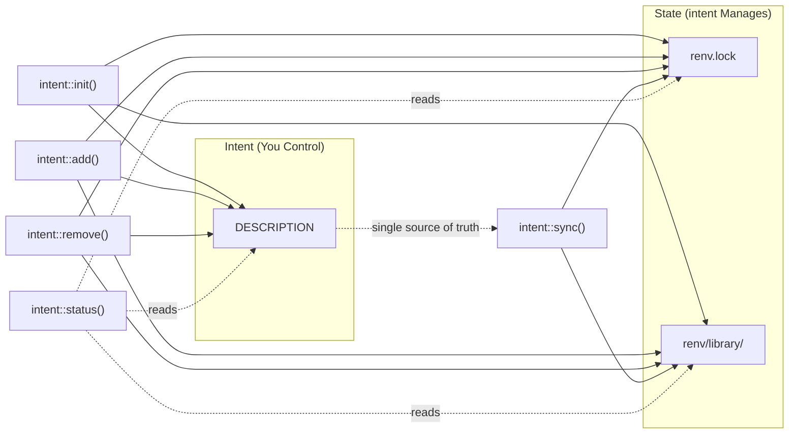

# intent: Fast, Unified Project Management for R

<!-- badges: start -->
[](https://lifecycle.r-lib.org/articles/stages.html#experimental)
[](https://github.com/SInginc/intent/actions/workflows/R-CMD-check.yaml)
<!-- badges: end -->

**`intent`** is a productivity-focused R package manager inspired by Python's `uv`. It provides a single interface to manage project dependencies, using the `DESCRIPTION` file as your **intent** (what you want) and `renv.lock` as your **state** (what you have).

## Why use `intent`?

In standard R, keeping your `DESCRIPTION` file, your installed packages, and your `renv.lock` file in sync is a manual, three-step process. **`intent`** automates this complexity:

* **Manifest-driven:** Uses the standard `DESCRIPTION` file as a `pyproject.toml` equivalent.
* **Blazing Fast:** Uses `pak` under the hood for multi-threaded installations.
* **Explicit Isolation:** Forces `renv` into "explicit" mode—no more accidental dependencies from "junk" scripts.
* **Contract Verification:** Checks that `DESCRIPTION`, repository policy,
  `renv.lock`, and the project library agree.
* **Zero-Config:** Automatically handles `.Rprofile` and repository settings.

---

## Quick Comparison

### intent vs Standard R Workflow

| Action | Standard R (Manual) | R (**`intent`**) |
| --- | --- | --- |
| **Initialize** | Create `DESCRIPTION` manually, run `renv::init()`, configure settings | `intent::init()` |
| **Adopt Existing** | Manual migration | `intent::adopt()` |
| **Add Dependency** | Edit `DESCRIPTION`, run `install.packages()`, run `renv::snapshot()` | `intent::add("pkg")` |
| **Remove Dependency** | Edit `DESCRIPTION`, run `remove.packages()`, run `renv::snapshot()` | `intent::remove("pkg")` |
| **Sync Environment** | Run `renv::restore()`, manually check consistency | `intent::sync()` |
| **Check Status** | Manually compare DESCRIPTION, lockfile, and library | `intent::status()` |
| **Verify Contract** | Manually inspect repository and lockfile invariants | `intent::verify()` |

### intent vs Python uv

| Action | Python (`uv`) | R (**`intent`**) |
| --- | --- | --- |
| **Initialize** | `uv init` | `intent::init()` |
| **Add Dependency** | `uv add pkg` | `intent::add("pkg")` |
| **Remove Dependency** | `uv remove pkg` | `intent::remove("pkg")` |
| **Sync Environment** | `uv sync` | `intent::sync()` |
| **Check Status** | `uv status` | `intent::status()` |
| **Verify Contract** | `uv lock --check` / CI checks | `intent::verify()` |

---

## Installation

```r
# Install from GitHub (recommended)
pak::pak("SInginc/intent")

# Or using remotes
remotes::install_github("SInginc/intent")
```

### CLI Setup

To use `intent` from the terminal, add the package's `exec` directory to your
`PATH`:

**Linux / macOS:**

```bash
# Add to ~/.bashrc, ~/.zshrc, or equivalent
export PATH="$PATH:$(Rscript -e 'cat(system.file("exec", package="intent"))')"
```

Alternatively, create a symlink to a directory already on your `PATH`:

```bash
ln -s $(Rscript -e 'cat(system.file("exec", package="intent"))')/intent \
  /usr/local/bin/intent
```

**Windows (PowerShell):**

```powershell
$intentDir = Rscript -e 'cat(system.file("exec", package="intent"))'
[Environment]::SetEnvironmentVariable("PATH", "$env:PATH;$intentDir", "User")
```

After setup, verify with:

```bash
intent --help
```

---

## Usage Example

### Terminal (CLI)

```bash
# Initialize a new project
intent init my_project
intent init my_project --yes
intent init my_project --repo INTERNAL=https://r.example.com/packages/latest

# Add dependencies
intent add dplyr
intent add ggplot2
intent add testthat --dev

# Check what's out of sync
intent status

# Preview changes before applying them
intent sync --dry-run

# Machine-readable sync preview (--json requires --dry-run)
intent sync --dry-run --json

# Sync environment
intent sync

# Remove a dependency
intent remove ggplot2
```

CLI previews print their action plans explicitly. Unsupported options are
rejected before execution. `intent adopt` previews by default; use `--apply`
to execute, and do not combine it with `--dry-run`. `--yes` only controls
prompting. JSON output is supported by status, verify/doctor, adopt, and sync
with `--dry-run`; add/remove do not accept `--json`.

### R API

```r
# Same commands, same behavior
intent::init("my_project")
intent::add("dplyr")
intent::add("ggplot2")
intent::add("testthat", dev = TRUE)
intent::status()
intent::sync(dry_run = TRUE)
intent::sync()
intent::remove("ggplot2")
```

### Workflow Diagram



---

## Key Functions

### `intent::init(path, repos, install_self = "hydrate")`

Initializes a new directory, or an existing directory that already has an
intent-compliant `DESCRIPTION`, as an `intent` project.

* Classifies `DESCRIPTION` before mutating project files.
* Creates a `DESCRIPTION` file only for new projects without existing `renv`
  state.
* Stops before writing if an existing `DESCRIPTION` is not intent-compliant.
* Stops before writing if `renv.lock` or `renv/` exists without a
  `DESCRIPTION`.
* Initializes a "bare" `renv` environment.
* Sets `renv` to **explicit mode** (only tracks packages in `DESCRIPTION`).
* Configures `.Rprofile` and `.Renviron` for automatic environment loading.
* Adds bootstrap tool dependencies. `intent` is written with a default
  lower-bound constraint, and `pak` / `renv` minimums are copied from the
  running `intent` package metadata when declared there.
* **Defaults to CRAN** at https://cran.r-project.org, named CRAN. Use
  repos = c(NAME = "URL") or INTENT_DEFAULT_REPOS to override.
* In interactive sessions, confirms the default repository before writing it.
  In non-interactive sessions, writes the default and prints how to declare
  project repositories explicitly.
* **Self-hydrates by default:** copies the currently installed `intent` package
  from your active library paths into the project library when possible, without
  assuming a remote source such as GitHub, CRAN, or R-universe.
* Use `install_self = "never"` if you want `intent` to remain an external tool.
* Records the tool lifecycle and reconciles all declared dependencies after setup.

### `intent::adopt(path, repos, strategy = "manifest", dry_run = TRUE, install_self = "hydrate")`

Adopts an existing R project into intent management. Unlike `init()`, which
creates brand-new projects or requires an intent-compliant DESCRIPTION,
`adopt()` converts a project that already has a DESCRIPTION and optionally an
existing `renv.lock` into an intent-managed project.

* **Default is non-mutating:** returns an `adoption_plan` that describes what
  would change. Pass `dry_run = FALSE` to apply changes.
* **Strategy `"manifest"`** (default): treats the existing `DESCRIPTION` as the
  source of direct dependency intent. Adds missing `Config/intent/repos/*`
  fields, bootstrap tool dependencies (`intent`, `pak`, `renv`), and
  `.Renviron` configuration. Reports packages in `renv.lock` that are not
  declared in `DESCRIPTION`.
* **Strategy `"lockfile-assisted"`**: also reads `renv.lock` to identify
  candidate dependencies for review.
* Validates that repository URLs are platform-agnostic, warns on
  platform-specific URLs that would break cross-platform restore.
* Writes `RENV_CONFIG_PAK_ENABLED = TRUE` to `.Renviron` when missing.
* Sets `renv` snapshot type to `"explicit"`.
* Self-hydrates `intent` by default (`install_self = "hydrate"`).
* CLI: `intent adopt [path] [--repo NAME=URL] [--strategy name] [--apply] [--yes]`

### `intent::add(pkgs, dev = FALSE, dry_run = FALSE)`

The primary way to grow your project.

* **Manifest Update:** Adds the specified package(s) to the `Imports` section of your `DESCRIPTION` (or `Suggests` when `dev = TRUE`).
* **Fast Install:** Uses `pak` to resolve and install the packages into your local project library.
* **Locking:** Updates `renv.lock` through a policy-aware candidate lockfile,
  so strict source policy can reject invalid provenance before replacing the
  official lockfile.
* **Dry Run:** Use `dry_run = TRUE` to preview planned actions without changing files.

### `intent::remove(pkgs, dry_run = FALSE)`

The clean-up tool.

* Removes the package from the `DESCRIPTION` file.
* Retains the package if another dependency still requires it; otherwise prunes it.
* Updates the `renv.lock` file through the same source-policy checks and prunes
  orphan dependencies.
* **Dry Run:** Use `dry_run = TRUE` to preview without changing files.

### `intent::sync(dry_run = FALSE, prune = TRUE)`

Reconciles declared dependencies with resolved and installed state.

* Resolves missing dependencies and incompatible versions or sources, preferring compatible locks.
* Restores a valid lock without rewriting it, including when the library is empty.
* **Prune:** Removes true orphans outside the dependency closure; prune = FALSE retains extras.
* **Source Policy:** Validates requested sources and candidate lockfiles before
  replacing `renv.lock` in strict mode.
* **Dry Run:** Use `dry_run = TRUE` to preview planned actions.
* Ideal for use after editing `DESCRIPTION` or after `git pull`.

### `intent::status()`

Reports drift between manifest, lockfile, and library **without changing anything**.

* Lists packages declared but not locked.
* Lists packages locked but not declared.
* Lists missing installations, incompatible declarations, and installed version/source drift.
* Reports source policy violations, such as repository packages resolved from a
  repository name not declared in `Config/intent/repos/`.
* Returns a structured object with `print()` and JSON (`as.character()`) output.
* CLI: use `intent status --json` for machine-readable output.

### `intent::verify()` / `intent::doctor()`

Verifies the project contract **without changing anything**.

* Checks that packages declared in `DESCRIPTION` are present in `renv.lock`.
* Checks locked versions and source identities against the project library.
* Fails only on errors; warnings and information remain visible.
* Checks that `renv.lock` repositories match `Config/intent/repos/`.
* Checks source policy violations and lockfile packages outside the dependency
  closure.
* Returns an `intent_verification` object with `ok`, `issues`, and the
  underlying `intent_status`.
* CLI: use `intent verify --json` for CI-friendly machine-readable output.

---

## Dependency Overrides

When you need a specific version of a package from a non-standard source, or
when the default CRAN version does not work for your project, use
**dependency overrides**. These are written as `Config/intent/` fields in your
`DESCRIPTION` file.

### Format

```dcf
Config/intent/Imports/<pkg>: <package-spec>@<version>@<source>
Config/intent/Suggests/<pkg>: <package-spec>@<version>@<source>
```

Each override must have exactly three non-empty fields separated by `@`.

### Supported Sources

| Source | Package Spec | Example | Description |
|--------|-------------|---------|-------------|
| `cran` | Bare name | `dplyr@1.1.4@cran` | Install a specific version from CRAN. |
| `standard` | Bare name | `dplyr@1.1.4@standard` | Same as `cran`. |
| `github` | `user/repo` | `tidyverse/dplyr@1.1.4@github` | Install a specific version from GitHub. |
| `bioc` | Bare name | `Biobase@3.18@bioc` | Install a specific version from Bioconductor. |
| `local` | Bare name | `mypkg@0.1.0@local` | Install from a local source package. |
| `url` | Bare name | `mypkg@0.1.0@url` | Install from a URL. |
| `https://...` | Bare name | `dplyr@1.1.4@https://example.com/cran` | Install from a custom CRAN-like repository. |

### Example

```dcf
Package: myproject
Imports:
    dplyr
Config/intent/Imports/dplyr: dplyr@1.1.4@cran
Config/intent/Imports/mypkg: myorg/mypkg@0.1.0@github
```

### Common Errors

| Error | Cause | Fix |
|-------|-------|-----|
| `Invalid override format: ... Expected package@version@source` | Missing or extra `@` separators, or an empty field. | Ensure exactly three non-empty parts separated by `@`. |
| `Invalid override source: ... Supported sources are cran, standard, github, bioc, local, url, or an http(s) repository URL` | Unknown source type. | Use one of the supported source values from the table above. |

---

## Repository & Source Policy

`intent` treats `DESCRIPTION` as the project policy file. Repository
configuration and source policy live under `Config/intent/`, so they are
reviewable in code review and portable across machines.

### Repositories

Repositories are declared as named fields:

```dcf
Config/intent/repos/RSPM: https://packagemanager.posit.co/cran/latest
Config/intent/repos/INTERNAL: https://r.example.com/packages/latest
```

When no repository is declared, `intent::init()` proposes Posit Package Manager
as:

```dcf
Config/intent/repos/RSPM: https://packagemanager.posit.co/cran/latest
```

The repository name matters, but intent uses URL-aware matching to avoid
spurious policy violations. If `renv.lock` records `Repository: RSPM` and a
declared repository points to the same Posit Package Manager URL — even under a
different name such as `CRAN` — the match succeeds. Lockfile repository names
that are not declared are supplemented into `$R$Repositories` at snapshot time
so `renv::restore()` can resolve them.

### Source Policy

Source policy controls which kinds of package sources are allowed:

```dcf
Config/intent/source-policy/mode: warn
Config/intent/source-policy/allow/repository: true
Config/intent/source-policy/allow/github: true
Config/intent/source-policy/allow/bioc: true
Config/intent/source-policy/allow/url: true
Config/intent/source-policy/allow/local: true
Config/intent/source-policy/allow/unknown: false
```

`mode` can be:

| Mode | Behavior |
|------|----------|
| `off` | Do not check package source provenance. |
| `warn` | Report source policy violations and continue. This is the default. |
| `error` | Fail mutating commands before replacing the official `renv.lock`. |

Source classes:

| Source | Meaning |
|--------|---------|
| `repository` | CRAN-like repositories, including CRAN, PPM, R-universe, and self-hosted repositories. |
| `github` | GitHub package references. |
| `bioc` | Bioconductor package references. |
| `url` | Direct URL package references. |
| `local` | Local package paths. |
| `unknown` | Lockfile records without enough source metadata. |

`intent`, `renv`, and `pak` are tool packages and are exempt from source policy
violations.

### Strict Mode

Projects that require tighter reproducibility can opt into strict policy:

```dcf
Config/intent/source-policy/mode: error
Config/intent/source-policy/allow/repository: true
Config/intent/source-policy/allow/github: false
Config/intent/source-policy/allow/bioc: false
Config/intent/source-policy/allow/url: false
Config/intent/source-policy/allow/local: false
Config/intent/source-policy/allow/unknown: false
```

In `error` mode, `intent::add()` and `intent::sync()` validate requested sources
before installation when possible, then write a candidate lockfile and validate
it before replacing the official `renv.lock`.

Dependency overrides are checked against the same policy. For example, a GitHub
override requires `Config/intent/source-policy/allow/github: true` unless policy
checking is turned off.

---

## Error Handling

| Scenario | Error Message | Solution |
| --- | --- | --- |
| No `DESCRIPTION` file | `"No DESCRIPTION file found. Run intent::init() first."` | Run `intent::init()` to initialize the project |
| No packages specified | `"No packages specified."` | Provide package names to `intent::add()` or `intent::remove()` |
| Missing `renv` or `pak` | `"The following required packages are missing: ..."` | Install `renv` and `pak` first |
| No repositories configured and defaults disabled | `"No repositories configured. Pass repos = ..."` | Pass `repos = c(NAME = "URL")`, use `intent init --repo NAME=URL`, or add `Config/intent/repos/` fields |
| Source policy violation | `"Source policy violation..."` | Update `Config/intent/source-policy/*`, use an allowed package source, or declare the repository under `Config/intent/repos/` |
| Platform-specific repository URL | `"uses a platform-specific URL"` | Replace with a platform-agnostic URL (e.g. `/cran/latest` instead of `/cran/__linux__/...`) |
| Lockfile repository not declared | `"references repository 'X' which is not declared"` | Add the repository name and URL to `Config/intent/repos/` in DESCRIPTION |

---

## .gitignore Recommendations

**Commit these files** (shared across team):
* `DESCRIPTION` — your project's intent (dependencies)
* `renv.lock` — exact versions for reproducibility
* `.Rprofile` — ensures `renv` activates on startup
* `renv/settings.json` — renv configuration
* `renv/activate.R` — renv bootstrap script

**Ignore these** (machine-specific):

```gitignore
# Local library (regenerated by intent::sync)
renv/library/

# renv staging/sandbox
renv/staging/
renv/sandbox/

# User-specific files
.Renviron
*.Rproj.user
```

---

## Migrating from Existing renv Projects

If you have an existing `renv` project, `intent::init()` will not infer project
intent from `renv.lock` alone. Prepare `DESCRIPTION` first:

```r
# 1. Ensure your DESCRIPTION lists all intended dependencies
#    (Check Imports and Suggests sections)

# 2. Add intent repository policy fields, for example:
#    Config/intent/repos/CRAN: https://cran.r-project.org

# 3. Set renv to explicit mode
renv::settings$snapshot.type("explicit")

# 4. Enable pak for faster installs
#    Add to .Renviron: RENV_CONFIG_PAK_ENABLED=TRUE

# 5. Run intent::init() after DESCRIPTION is intent-compliant,
#    then sync to ensure consistency
intent::init()
intent::sync()
```

> **Note:** After migration, use `intent::add()` and `intent::remove()` instead of manually editing `DESCRIPTION`.

---

## The `intent` Philosophy: "Intent vs. State"

`intent` enforces a strict separation between what you *intend* to use and the *state* of your machine:

1. **Intent (`DESCRIPTION`):** You edit this (or use `intent::add()`). It lists top-level packages and version constraints.
2. **State (`renv.lock`):** `intent` manages this. It is a machine-readable JSON containing the exact version and hash of every nested dependency.

> **Note:** By using `intent`, you never have to worry about `renv` scanning your entire folder for `library()` calls. If it's not in the `DESCRIPTION`, it's not in the project.

---

## Workflow contracts and backend boundaries

Intent owns dependency declarations, validation and user-facing verbs.
Environment libraries, activation and package transport remain backend mechanics.

- [Product boundary](docs/06-product-boundary.md)
- [Workflow contracts](docs/08-workflow-contracts.md)
- [Implementation decisions and acceptance scenarios](docs/refactors/029-dependency-contract-enforcement.md)
- [Backend evidence and limitations](docs/09-backend-capability-matrix.md)

A compatible lock is restored without rewriting it. Missing or incompatible
resolved state triggers staged resolution, preferring compatible locked versions.
The candidate is validated before target restoration and committed only after
installed-state verification succeeds. A failed operation retains the official
lock; manifest edits may remain pending and library rollback is not guaranteed.
Correct the failure and rerun sync.

Exact historical versions use explicit package references. Automatic search
over archived versions under upper constraints is not implemented by the current
resolver; failure must never silently relax the declared constraint.
